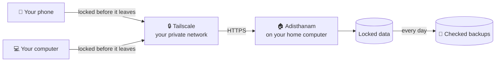

<h1 align="center">
  <br>
  <a href="https://github.com/sudharamachandranrajeev/adisthanam"></a>
  <br>
  Adisthanam
  <br>
</h1>

<h4 align="center">Your own private server for every Brahma app: one sign-in, all your data, set up on a home computer with one command.</h4>

<p align="center">
  <a href="https://github.com/sudharamachandranrajeev/adisthanam/releases"></a>
  
  
  <a href="https://github.com/sudharamachandranrajeev/brahma"></a>
</p>

<p align="center">
  <a href="#-what-it-does">What it does</a> •
  <a href="#-install">Install</a> •
  <a href="#-how-it-works">How it works</a> •
  <a href="#-faq-and-troubleshooting">FAQ</a> •
  <a href="#%EF%B8%8F-for-developers">For developers</a>
</p>

Adisthanam (अधिष्ठानम्, "foundation") turns a computer you own into the sync server for the
Brahma apps: Brahma, Artha, Vidya, Udyoga and the rest. Every device locks (encrypts) its data
before sending it, so the server keeps everything and can read none of it. Status: **in
development**, version 0.1.0, no release yet. Only the home-computer setup works today.

## ✨ What it does

- 🏠 **One command at home** – `adisthanam install` sets up an old laptop or desktop as your
  server. Running it again checks each step and repairs what is missing.
- 🔑 **One sign-in for every app** – one account works in every Brahma app. Only you can create
  the first account, with a one-time setup link.
- 🙈 **Private by default** – the server is reachable only through Tailscale (a free private
  network between your own devices), over HTTPS. Nothing is opened to the internet.
- 🧱 **Fenced in** – it runs as its own user in a locked-down service (a systemd sandbox), with
  no access to your files and capped memory, so it cannot slow down or harm the computer.
- 💾 **Daily backups** – a copy every day, checked by opening it again, moved where the server
  itself cannot change it. The newest 14 are kept.
- ↩️ **Easy to undo** – restore a backup, go back to the previous version, or uninstall. A
  restore saves the current data first, and uninstall keeps it.
- 🔄 **Syncthing to plan** (optional) – keeps file sync between your own computers private and the
  same on each one, and refuses changes that could lose files.
- 🚚 **Moves from the old Brahma home server** – brings its accounts along, so every device stays
  signed in.

<details>
<summary><b>Coming in later releases</b></summary>

| Planned | What it adds |
| --- | --- |
| Rented server, Docker, Cloudflare | `--target vps`, `docker` and `cloudflare`, for a server away from home |
| `adisthanam doctor` | Checks the firewall, Tailscale, backups, disk, clock and certificates, in plain words |
| Signed `update` | Backs up, installs a signed release, and rolls back by itself if it fails |
| `export` / `import` | Moves every account to a new server, with no one signing in again |
| Encrypted off-site copies | Backups to a USB disk or storage that cannot be overwritten from here |
| Health and network watch | Alerts on your phone for crashes, a full disk, new open ports or many failed sign-ins |

</details>

## 🚀 Install

### Step 1 – Check what you need

A Linux computer that stays on and plugged in. An old laptop is fine. It needs:

| You need | Why | How to check |
| --- | --- | --- |
| systemd 250 or newer | runs the server and seals its secrets | `systemctl --version` |
| Node.js 24 or newer at `/usr/bin/node` | runs the server | `/usr/bin/node --version` |
| Tailscale 1.102.3 or newer, signed in | private access and HTTPS | `tailscale status` |
| An active `ufw` firewall | only Tailscale may reach the server | `sudo ufw status` |
| Git and curl | fetch and check the server | `git --version` |

Install Node.js with your system's package manager (on Arch: `sudo pacman -S nodejs-lts-krypton`).
A Node.js in your home folder is refused on purpose: the server must not run code that can be
changed without `sudo`. Install [Tailscale](https://tailscale.com/download) on the server and on
every phone and computer that should sync.

### Step 2 – Install

1. Open a terminal on the server computer and get Adisthanam:
   ```sh
   git clone https://github.com/sudharamachandranrajeev/adisthanam
   cd adisthanam
   ```
2. Optional: see every step without changing anything:
   ```sh
   sudo ./adisthanam install --target home --dry-run
   ```
3. Install. `--node-name` gives this computer a neutral Tailscale name. Pick one that says nothing
   about you: it appears in public certificate logs once HTTPS is on.
   ```sh
   sudo ./adisthanam install --target home --node-name home-server
   ```
4. Wait for **Connect your apps**. It prints a **setup link** starting with `brahma://setup`, and a
   QR code if `qrencode` is installed.

Every command that changes the system is printed before it runs.

> [!NOTE]
> Moving from the older Brahma home server? Add `--import-legacy ~/.local/share/brahma-server`
> to step 3. It copies the accounts and the signing key, so every device stays signed in. The old
> copy stays where it was until you delete it.

### Step 3 – Connect your apps

1. In any Brahma app, choose **Sync across my devices → I already have a server**.
2. Paste the setup link, or scan the QR code with your phone's camera.
3. Choose **Create account**. This makes you the owner. The link stops working after that.
4. **Write down the recovery key** the app shows, and keep it away from the device.
5. To add family later: **Settings → Sync → Invite someone**. Each person gets a private account.

Lost the link before creating the account? Run `sudo adisthanam link` to see it again.

### Step 4 – Finish by hand

The installer ends with a short **Still to do by hand** list. Do it once: in the Tailscale admin
console, let only your family reach this server and turn on device approval. Keep exit node,
subnet routes and Funnel off on this computer.

## 🧰 Looking after it

| Command | What it does |
| --- | --- |
| `sudo adisthanam status` | Running? Version, accounts, devices, database check, last and next backup |
| `sudo adisthanam link` | Shows the setup link again (until the owner account exists) |
| `sudo adisthanam backup` | Backs up now (a daily backup also runs by itself) |
| `adisthanam verify FILE` | Checks a backup without changing it |
| `sudo adisthanam restore FILE` | Puts a backup back (the current data is saved first) |
| `sudo adisthanam rollback` | Goes back to the previous version |
| `sudo adisthanam uninstall` | Removes the server, but keeps data, backups and secrets |
| `adisthanam sync status` | Checks this computer's Syncthing against your plan (no `sudo`) |

Backups are in `/var/backups/adisthanam`. To keep file sync between your own computers private
with Syncthing, see [Syncthing between your own computers](docs/sync.md).

## 🧭 How it works



- **Each device** encrypts its changes before sending them. Only your devices hold the key.
- **Tailscale** carries them to the server over HTTPS. The firewall lets in nothing else, apart
  from SSH over Tailscale.
- **The server** listens on this computer only, stores the locked data, and passes it on to your
  other devices.
- **Each day** a backup is made, opened again to check it, and moved out of the server's reach.

## 🔒 Your data

- **The server can see** account e-mail addresses, device names and ids, when each device
  synced, and how much it sent.
- **It cannot see** anything you type into an app. Rows are encrypted on the device with keys
  made from your password. The password itself never reaches the server.
- **Where it lives**: data in `/var/lib/adisthanam`, backups in `/var/backups/adisthanam`, and
  the two secrets sealed with `systemd-creds` (to the TPM chip when the computer has one).
- **What the server downloads**: CISA's public list of known security flaws, at most twice a day,
  for the apps' Sentinel security checks. Nothing about you is sent.
- **Backups** hold the same locked rows, plus the account list. Copy them to a USB disk yourself
  until off-site copies arrive.

> [!IMPORTANT]
> Your password and recovery key are the only ways to unlock your data. If you lose both, nobody
> can recover it, not even the server owner. `uninstall` keeps the data and secrets; delete them
> only when you are sure.

## ❓ FAQ and troubleshooting

<details>
<summary><b>Do I need to leave the computer on?</b></summary>

Yes, and plugged in. The installer stops the computer from sleeping and keeps it running with the
lid closed. The lid setting takes effect after the next restart.
</details>

<details>
<summary><b>"No Node.js at /usr/bin/node", or a Node.js in my home folder is refused</b></summary>

Install Node.js 24 or newer with your system's package manager, so it lands in `/usr/bin`. This
is on purpose: code in your home folder could be changed without `sudo`.
</details>

<details>
<summary><b>"Tailscale is not signed in" or "No active ufw firewall"</b></summary>

Run `sudo tailscale up` and sign in, or install `ufw` and run `sudo ufw enable`. Then run the
install command again; it carries on from there.
</details>

<details>
<summary><b>Will it lock me out of SSH?</b></summary>

No. SSH becomes keys-only, and only over Tailscale, but only when you already have an SSH key set
up. Without one, SSH is left as it was. A setting `sshd` rejects is removed straight away.
</details>

<details>
<summary><b>The server does not start</b></summary>

Run `sudo adisthanam status`, then `journalctl -u adisthanam -n 50` for the reason. After 5
crashes in 5 minutes it stops trying, so a fault cannot hide.
</details>

## 🛠️ For developers

<details>
<summary>Test, scan and change the pinned server</summary>

You need Node.js 24 or newer, and [gitleaks](https://github.com/gitleaks/gitleaks) for the scan.

```sh
npm test                               # fetches the pinned Brahma server, then tests it as a real process
npm run check                          # secret scan (gitleaks) and the personal-information scan
git config core.hooksPath .githooks    # run the scan before every commit and push
```

- The Brahma server commit Adisthanam runs is pinned in `brahma.lock`. To upgrade, change the
  commit, run `npm test`, and read the server's changelog first.
- Every commit is scanned for secrets and for anything that points at a person, home or machine.
  Examples use documentation addresses only (`192.0.2.0/24`, `2001:db8::/32`, `example.com`).
- Service files are in `install/units/`; the command itself is the `adisthanam` script.

</details>

<details>
<summary>Credits</summary>

- [Brahma sync server](https://github.com/sudharamachandranrajeev/brahma/tree/main/server), the
  protocol Adisthanam runs
- [Node.js](https://nodejs.org) and its built-in `node:sqlite`
- [Tailscale](https://tailscale.com) for private access and HTTPS
- [systemd](https://systemd.io) for the sandbox, timers and sealed secrets
- [ufw](https://launchpad.net/ufw) for the firewall
- [Syncthing](https://syncthing.net) for file sync between your computers
- [gitleaks](https://github.com/gitleaks/gitleaks) for the secret scan

</details>

## Related

Adisthanam is the server for the **Brahma** family. Every app below signs in to it.

| App | What it does |
| --- | --- |
| [brahma](https://github.com/sudharamachandranrajeev/brahma) | The shared core, the all-in-one app and the sync server |
| [artha](https://github.com/sudharamachandranrajeev/artha) | Money, accounts and investments |
| [vidya](https://github.com/sudharamachandranrajeev/vidya) | Learning, flashcards and focus |
| [udyoga](https://github.com/sudharamachandranrajeev/udyoga) | Career and job hunting |
| [graha-anveshana](https://github.com/sudharamachandranrajeev/graha-anveshana) | Find a home to rent or buy |
| [vahana-anveshana](https://github.com/sudharamachandranrajeev/vahana-anveshana) | Find a car |
| [bhojana](https://github.com/sudharamachandranrajeev/bhojana) | Groceries and shopping |
| [bahya-nireekshana](https://github.com/sudharamachandranrajeev/bahya-nireekshana) | Network monitoring |

## License

No licence has been chosen yet; all rights reserved.

---

> GitHub [@sudharamachandranrajeev](https://github.com/sudharamachandranrajeev)
